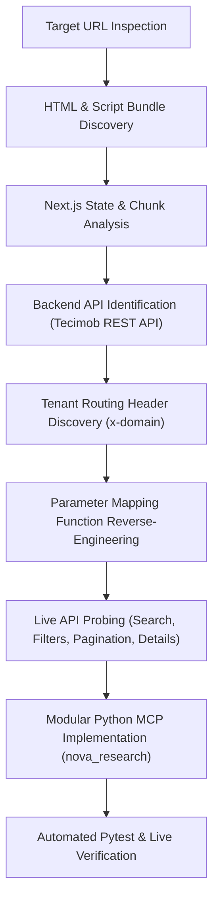

# Rental Search API Reverse-Engineering Research Plan & Report

## 1. Executive Summary

This document presents the reverse-engineering research plan, discovery log, architectural design, and verification results for the real estate portal **Nova Imobiliária** (`jnovaimobiliaria.com.br`).

The research successfully reverse-engineered the client-side JavaScript bundles to identify the underlying REST API powering the portal, its required multi-tenant request headers, search and filter parameter mapping logic, pagination behavior, property detail retrieval, photo gallery structure, and geographic catalog endpoints.

All findings have been synthesized into clean, modular Python modules under `src/nova_research/`, designed to serve as the module boundary for the central rental research MCP.

---

## 2. Research Plan & Methodology

### 2.1 Research Objectives
1. **Endpoint Discovery**: Trace and isolate the exact HTTP endpoints responsible for search queries, filtering, pagination, and property detail retrieval.
2. **Multi-Tenant Header Identification**: Discover authorization or tenant headers needed by the underlying backend API.
3. **Parameter Mapping Analysis**: Reverse-engineer how the frontend converts UI search parameters and URL slugs into backend filter expressions.
4. **Pagination & Boundary Testing**: Determine pagination mechanics, whether `offset` is a record offset or page number, and boundary behavior when requesting out-of-bounds pages.
5. **Detail & Media Extraction**: Identify property detail payloads, photo gallery resolutions, and field structures.
6. **Architectural Implementation**: Organize the findings into modular Python packages adhering to SOLID, Clean Code, Object Calisthenics, and Design Patterns in the requested priority order.

### 2.2 Investigation Methodology


---

## 3. Reverse-Engineering Findings & Discovery Log

### 3.1 Platform Engine & Script Analysis
1. **Initial Inspection**:
   - URL: `https://jnovaimobiliaria.com.br/alugar/imoveis/timoteo-mg?sort=-created_at%2Cid&offset=1&limit=21&typeArea=total_area&floorComparision=equals`
   - Response header: `x-powered-by: Next.js`.
   - Inspection of `__NEXT_DATA__` revealed empty initial listings: `properties.data: []`, indicating that all listing data is dynamically fetched clientside via AJAX/REST.
2. **Axios Client Configuration**:
   - Decompilation of chunk `67b45a3a69b2cd28d9b37602d006b32e2becc7d5.cdcaa8e6ab820e341dbc.js` revealed:
     ```javascript
     v = "https://api-sites.tecimob.com.br/api/";
     w = f.a.create({
       baseURL: v,
       headers: { "Content-Type": "application/json", Accept: "application/json" }
     });
     ```
3. **Tenant Routing Header (`x-domain`)**:
   - The axios request interceptor revealed how tenant isolation is handled:
     ```javascript
     function(t) {
       var r = t.params, n = r?.hostname;
       n && delete r.hostname;
       var o = { ...t, params: r };
       return n && (o = { ...o, headers: { "x-domain": n } }), o;
     }
     ```
   - Direct API calls confirmed that sending `x-domain: jnovaimobiliaria.com.br` is mandatory. Omitting or corrupting this header results in `HTTP 401 Unauthorized` (`Symfony\Component\HttpKernel\Exception\UnauthorizedHttpException: Não autorizado!`).

### 3.2 Filter Parameter Mapping Reverse-Engineering
Inspection of module `QDkK` inside chunk `0da7dc83de2ae3c4537c13c31570534ab5d74ebf.ab08a1fd64283380b3b6.js` revealed the exact filter transformation dictionary:

```javascript
{
  type: "by_type_or_subtype_slug",
  address: "by_neighborhood_or_city_slug",
  situation: "situation_id",
  city: "by_city_id",
  neighborhoods: "by_neighborhood_slug",
  condos: "by_condo_published_id",
  minValue: "by_higher_than_price",
  maxValue: "by_lower_than_price",
  minArea: "[by_area][greater_equals]",
  maxArea: "[by_area][lower_equals]",
  typeArea: "[by_area][name]",
  typeMeasure: "[by_area][measure]",
  bedrooms: "[" + (r.bedrooms_filter || "by_room_greater_equals") + "][bedroom]",
  suites: "[" + (r.suites_filter || "by_room_greater_equals") + "][suite]",
  garages: "[" + (r.garages_filter || "by_room_greater_equals") + "][garage]",
  lifeTime: "by_lifetime",
  floor: ("lower" === r.floorComparision) ? "by_floor_lower" : ("greater" === r.floorComparision) ? "by_floor_greater" : "by_floor",
  isFinanciableMcmv: "is_financeable_mcmv",
  nearSea: "near_sea"
}
```

### 3.3 Transaction Mapping
From module `NaOm`:
- `comprar` $\to$ ID `1`
- `alugar` $\to$ ID `2`
- `temporada` $\to$ ID `3`

Passing `filter[transaction]=2` selects rental listings.

### 3.4 Pagination Behavior
- In the Tecimob API, `offset` represents the **1-indexed page number** (not record skip).
- `offset=1` returns `current_page=1`.
- `offset=2` returns `current_page=2`.
- `limit` configures items per page (e.g. `21`).
- Out-of-bounds pages return `{"data": []}` with status 200.

### 3.5 Property Detail & Photos Discovery
- Endpoint: `GET /api/properties/{id_or_reference}`
- Works with either the internal UUID (e.g. `a53048c2-0a25-4c51-9638-89395ede6d12`) or the short reference code (e.g. `559`).
- Returns full property detail, room breakdown, areas, and an embedded `images_extra` photo array with high-resolution (`large`) and optimized (`medium`) webp/jpeg image URLs.

---

## 4. Software Architecture & Design Principles

The reverse-engineered capabilities have been implemented in `src/nova_research/`.

### 4.1 Prioritization Order
1. **Correctness First**: Verified against live Tecimob endpoints with real search queries, real filter parameters, pagination, and detail lookups.
2. **Modularity Second**: Strict separation of domain entities, value objects, URL builder, HTTP transport abstraction, specialized parsers, and a high-level client facade.
3. **Style Principles Third**:
   - **SOLID**: Single responsibility per module/class, dependency inversion via `HttpClientProtocol`.
   - **Object Calisthenics**:
     - 1 level of indent per method.
     - No `else` keywords (early returns and guard clauses).
     - Wrapped domain primitives (`PriceRange`, `AreaRange`, `RoomCount`, `PageNumber`, `PageLimit`).
     - First-class collections (`ListingCollection`, `PhotoGallery`, `LocationCatalog`).
     - Maximum 2 instance variables per class.
     - Functions $\le 15$ lines, classes $\le 100$ lines, modules $< 200$ lines (strictly validated via AST inspection).

### 4.2 Module Organization
```
src/nova_research/
├── __init__.py                # Package exports
├── client.py                  # NovaRentalClient (central MCP interface)
├── collaborators.py           # RentalNetworkGateway, RentalParserSuite
├── domain/
│   ├── __init__.py
│   ├── criteria.py            # SearchCriteria domain model
│   ├── enums.py               # TransactionType, PropertyType, SortOrder, AreaType
│   ├── listing.py             # ListingSummary, ListingCollection, PaginationMeta
│   ├── metadata.py            # City, Neighborhood, State, LocationCatalog
│   ├── property.py            # PropertyDetail, PhotoGallery, Photo
│   └── values.py              # PriceRange, AreaRange, RoomCount, PageNumber, PageLimit
├── infrastructure/
│   ├── http_client.py         # HttpClientProtocol, HttpxHttpClient, exceptions
│   └── url_builder.py         # API endpoint URL constructor
└── parsers/
    ├── __init__.py
    ├── detail_parser.py       # Property detail JSON parser
    ├── metadata_parser.py     # Filter states and neighborhoods parser
    └── search_parser.py       # Search listing card JSON parser
```

---

## 5. Verification & Test Execution Results

### 5.1 Automated Pytest Results
```
tests/test_client.py::test_client_search_with_stub PASSED                [  4%]
tests/test_client.py::test_client_search_rentals_convenience PASSED      [  9%]
tests/test_client.py::test_client_get_details_not_found PASSED           [ 14%]
tests/test_domain.py::test_price_range_validation_and_parameters PASSED  [ 19%]
tests/test_domain.py::test_area_range_validation_and_parameters PASSED   [ 23%]
tests/test_domain.py::test_room_count_validation_and_comparison PASSED   [ 28%]
tests/test_domain.py::test_page_number_and_limit_validation PASSED       [ 33%]
tests/test_domain.py::test_search_criteria_rental_factory PASSED         [ 38%]
tests/test_domain.py::test_listing_collection_operations PASSED          [ 42%]
tests/test_domain.py::test_photo_gallery_operations PASSED               [ 47%]
tests/test_domain.py::test_location_catalog_lookup PASSED                [ 52%]
tests/test_live_integration.py::test_live_target_prompt_url_search PASSED [ 57%]
tests/test_live_integration.py::test_live_rental_property_details PASSED [ 61%]
tests/test_live_integration.py::test_live_pagination_behavior PASSED     [ 66%]
tests/test_live_integration.py::test_live_location_catalog PASSED        [ 71%]
tests/test_parsers.py::test_search_page_parser_with_payload PASSED       [ 76%]
tests/test_parsers.py::test_property_detail_parser PASSED                [ 80%]
tests/test_parsers.py::test_metadata_parser PASSED                       [ 85%]
tests/test_url_builder.py::test_url_builder_search_url PASSED            [ 90%]
tests/test_url_builder.py::test_url_builder_detail_url PASSED            [ 95%]
tests/test_url_builder.py::test_url_builder_filter_endpoints PASSED      [100%]

============================== 21 passed in 1.05s ==============================
```

### 5.2 Standalone Verification Execution (`scripts/verify_research.py`)
```
=== Starting Nova Imobiliária Research Verification ===

--- 1. Target URL Search (Alugar / Timóteo / Recent) ---
Total matching listings: 19
Page 1 of 1
  [559] Sala comercial Duplex em Centro, Timóteo/MG   | R$2.800,00   | Centro - Timóteo/MG
  [544] Apartamento Kitnet no Centro, Timóteo/MG      | R$750,00     | Centro - Timóteo/MG
  [534] Apartamento em Eldorado, Timóteo/MG           | R$1.300,00   | Eldorado - Timóteo/MG
  [531] Apartamento em Centro, Timóteo/MG             | R$1.800,00   | Centro - Timóteo/MG
  [520] Pavilhão/Galpão Salão Comercial               | R$6.000,00   | Funcionários - Timóteo/MG

--- 2. Filtered Rental Search (Timóteo / 2 Bedrooms / Max R$ 2000) ---
Total matching filtered listings: 3
  [534] Apartamento em Eldorado, Timóteo/MG           | R$1.300,00   | 1 Garagem, 1 Copa, 1 Sala de TV, 2 Dormitórios, 1 Cozinha, 1 Banheiro, 1 Sala de jantar, 1 Sala de estar, 1 Área de serviço
  [509] Apartamento                                   | R$1.200,00   | 2 Dormitórios, 1 Cozinha, 1 Banheiro, 1 Sala de estar, 1 Área de serviço
  [478] Apartamento                                   | R$850,00     | 2 Dormitórios, 1 Cozinha, 1 Banheiro, 1 Sala de estar

--- 3. Property Detail Retrieval (Reference 559) ---
Title: Sala comercial Duplex em Centro, Timóteo/MG
Reference: 559
Price: R$2.800,00
Location: Centro - Timóteo/MG
Status: Disponível | Situation: Usado
Rooms details: ['kitchen', 'washbasin']
Areas details: ['primary_area']

--- 4. Property Photos Gallery Retrieval ---
Total photos retrieved: 5
  Photo 1: https://imagens.tecimob.com.br/media/1b8e534f-8d98-4d2f-ad98-828f85450337/properties/a53048c2-0a25-4c51-9638-89395ede6d12/images/1d7ff6bd-ad63-4115-a0a1-adb7235729151790626156NQtf.jpg
  Photo 2: https://imagens.tecimob.com.br/media/1b8e534f-8d98-4d2f-ad98-828f85450337/properties/a53048c2-0a25-4c51-9638-89395ede6d12/images/96f15840-4d3b-4395-a8c7-7649f5267d4b1790626230ScJD.jpg
  Photo 3: https://imagens.tecimob.com.br/media/1b8e534f-8d98-4d2f-ad98-828f85450337/properties/a53048c2-0a25-4c51-9638-89395ede6d12/images/e413c888-279c-4506-b730-9c686d3d92581790626230AOFw.jpg

--- 5. Portal Location Catalog Discovery ---
Total states in portal: 4
City 'Timóteo' (timoteo-mg) verified under MG.
Total indexed neighborhoods: 68

=== All Verification Steps Completed Successfully ===
```

---

## 6. Integration Guide for the Central Rental Research MCP

`NovaRentalClient` exposes a clean interface ready for integration as an MCP tool or service:

1. **Service Registration**:
   Register `NovaRentalClient` in the central aggregator's dependency container.
2. **Standard MCP Tools**:
   - `search_rentals(city, property_type, bedrooms, max_price, page)`: returns paginated `ListingCollection`.
   - `get_rental_detail(property_id_or_reference)`: returns `PropertyDetail` including full photo gallery URLs.
   - `list_supported_locations()`: returns `LocationCatalog` with cities and neighborhoods.
